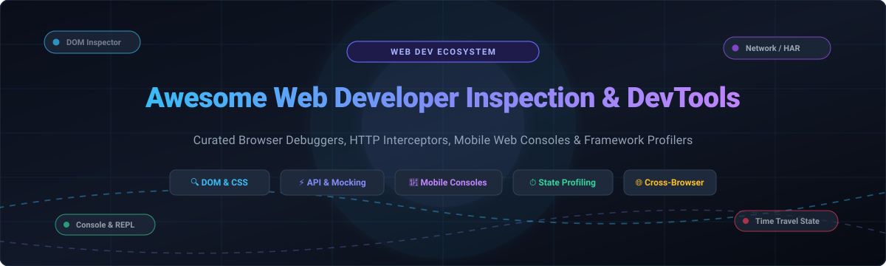

# 🛠️ Awesome Web Developer Inspection & DevTools

  
  
  
  
  
  
  

  <strong>⚡ A meticulously curated catalog of top-tier Web Developer Inspection tools, browser DevTools suites, network interception proxies, mobile in-app consoles, and reactive framework profilers. ⚡</strong>

  🌟 <em>Star this repository if you find it helpful for your developer workflow!</em> 🌟

---

## 📋 Table of Contents

- [🌐 Sector Overview & Market Dynamics](#-sector-overview--market-dynamics)
- [🟦 SaaS / Commercial Hosted Platforms](#-saas--commercial-hosted-platforms)
- [🟩 Open-Source Software](#-open-source-software)
  - [⚡ Hoppscotch](#-hoppscotch)
  - [📁 Bruno](#-bruno)
  - [🛡️ mitmproxy](#️-mitmproxy)
  - [📬 Insomnia](#-insomnia)
  - [⚙️ Chromium DevTools Protocol & Core](#️-chromium-devtools-protocol--core)
  - [💚 Vue Devtools](#-vue-devtools)
  - [📱 Eruda Console](#-eruda-console)
  - [📲 vConsole](#-vconsole)
  - [🔄 Redux DevTools](#-redux-devtools)
  - [⚛️ React Developer Tools](#️-react-developer-tools)
  - [🧭 WebKit Web Inspector](#-webkit-web-inspector)
  - [🔀 Requestly Core](#-requestly-core)
  - [🖥️ Chrome DevTools Frontend](#️-chrome-devtools-frontend)
  - [🦊 Firefox DevTools](#-firefox-devtools)
  - [🔗 Chii Remote DevTools](#-chii-remote-devtools)
- [📊 Comparison at a Glance](#-comparison-at-a-glance)
- [🎯 Developer Selection Guide](#-developer-selection-guide)
- [💖 Support & Community](#-support--community)
- [📈 Star History](#-star-history)
- [🤝 Contributing](#-contributing)
- [📄 License](#-license)

---

## 🌐 Sector Overview & Market Dynamics

The global software development tools and web testing market is estimated at **$32 billion to $45 billion**, projected to exceed **$80+ billion by 2032** at a ~15% CAGR driven by rapid microservice adoption, cross-platform web ecosystems, and automated debugging requirements. The sector is **moderately fragmented**: built-in browser debugging suites (dominated by Chromium/Blink and Apple WebKit) and dominant API hubs hold strong oligopolistic concentration, whereas specialized verticals—such as HTTP interception, mock servers, mobile web remote consoles, and framework runtime inspectors—thrive on open-source community innovation and specialized developer toolchains.

---

## 🟦 SaaS / Commercial Hosted Platforms

Commercial, cloud-hosted Web Developer Inspection and DevTools platforms sorted descending by company scale (valuation / annual recurring revenue).

| Platform | Company Scale (Valuation / Revenue) | Starting Price (Billed Annually) | Free Tier Limits / Free Trial Details | Primary Inspection Focus | Best For |
| :--- | :--- | :--- | :--- | :--- | :--- |
| **[Postman](https://www.postman.com)** | **$5.6B Valuation** (~$313M ARR) | **$19/user/month** (Team tier, billed annually) | **Free Forever plan**: Limited to 1 user (solo), unlimited collection runs, up to 1,000 monitoring requests/month, 50 AI credits/month, 10,000 Postman API calls/month, and max 5 external integrations. | API inspection, HTTP mock servers, request debugging, collection orchestration. | End-to-end API lifecycle management, collaborative API specs, and automated collection testing. |
| **[BrowserStack](https://www.browserstack.com)** | **$4.0B Valuation** (~$225M ARR) | **$29/user/month** (Live Desktop tier, billed annually) | **Free Trial only**: 30 minutes of interactive manual live browser testing session time across 3,000+ real desktop/mobile devices and browsers (no perpetual free plan). | Cross-browser DOM inspection, remote real-device hardware/browser debugging, automated selenium grids. | Enterprise cross-browser layout verification, native mobile browser testing, remote visual bug audits. |
| **[Requestly](https://requestly.com)** | **$3M ARR** *(Acquired by BrowserStack)* | **$10/user/month** (Team Basic tier, billed annually) | **Free Forever plan**: Limited to 3 active HTTP/network interception rules simultaneously, 1 workspace member, and basic client-side mock response rules. | Client-side HTTP/HTTPS request modification, URL redirection, header manipulation, API mocking. | Frontend dev mock workflows, staging-to-production script injection, traffic redirection without code changes. |

---

## 🟩 Open-Source Software

Self-hosted, community-driven Web Developer Inspection and DevTools. Ranked in descending order by GitHub community star counts.

### ⚡ [Hoppscotch](https://hoppscotch.com) 
- **GitHub:** [`hoppscotch/hoppscotch`](https://github.com/hoppscotch/hoppscotch)
- **Tech Stack:** TypeScript / Vue.js / Nuxt / WebAssembly
- **License:** MIT
- **Key Capabilities:** Ultra-fast, lightweight web API development ecosystem designed as a self-hostable alternative to Postman. Supports REST, GraphQL, WebSocket, Server-Sent Events (SSE), Socket.IO, and MQTT protocols with minimal resource overhead. Features zero-install web usage, PWA, desktop binaries (Tauri), and collaborative workspace environments.

### 📁 [Bruno](https://www.usebruno.com) 
- **GitHub:** [`usebruno/bruno`](https://github.com/usebruno/bruno)
- **Tech Stack:** JavaScript / Electron / React
- **License:** MIT
- **Key Capabilities:** Fast, offline-first open-source API exploration and inspection client. Stores collections directly within filesystem folders using the human-readable plain-text Bru markup language, allowing collections to live inside Git repositories and be versioned via Git PR reviews without cloud lock-in.

### 🛡️ [mitmproxy](https://mitmproxy.org) 
- **GitHub:** [`mitmproxy/mitmproxy`](https://github.com/mitmproxy/mitmproxy)
- **Tech Stack:** Python
- **License:** MIT
- **Key Capabilities:** Interactive man-in-the-middle SSL/TLS-capable HTTP/1, HTTP/2, and WebSockets inspection proxy. Comes equipped with a terminal UI (`mitmproxy`), a browser-based web dashboard (`mitmweb`), and an extensible Python scripting engine for intercepting, modifying, replaying, and decoding client-server web traffic in real time.

### 📬 [Insomnia](https://insomnia.rest) 
- **GitHub:** [`Kong/insomnia`](https://github.com/Kong/insomnia)
- **Tech Stack:** TypeScript / Electron
- **License:** Apache-2.0
- **Key Capabilities:** Robust desktop API design, debugging, and inspection tool maintained by Kong. Combines REST, SOAP, GraphQL, and gRPC debugging with native OpenAPI generation, Git sync capabilities, and environment credential management.

### ⚙️ [Chromium DevTools Protocol & Core](https://www.chromium.org) 
- **GitHub:** [`chromium/chromium`](https://github.com/chromium/chromium)
- **Tech Stack:** C++ / JavaScript
- **License:** BSD-3-Clause
- **Key Capabilities:** Powers the underlying developer tool infrastructure in Google Chrome, Microsoft Edge, Brave, and Opera. Provides deep engine-level hooks through the Chrome DevTools Protocol (CDP) for instrumentation, inspection, memory heap analysis, rendering timeline profiling, and remote automated control via Puppeteer and Playwright.

### 💚 [Vue Devtools](https://devtools.vuejs.org) 
- **GitHub:** [`vuejs/devtools-v6`](https://github.com/vuejs/devtools-v6)
- **Tech Stack:** TypeScript / Vue.js
- **License:** MIT
- **Key Capabilities:** Official browser extension and standalone inspector for Vue.js applications (supporting Vue 2, Vue 3, Vite, and Nuxt). Delivers component tree inspection, Pinia and Vuex reactive state time-travel debugging, event timeline tracking, component performance benchmarks, and custom plugin inspectors.

### 📱 [Eruda Console](https://eruda.liriliri.io) 
- **GitHub:** [`liriliri/eruda`](https://github.com/liriliri/eruda)
- **Tech Stack:** JavaScript
- **License:** MIT
- **Key Capabilities:** Comprehensive in-browser mobile console and DevTools panel designed for mobile web browsers where native F12 inspection is unavailable. Renders a draggable floating button displaying interactive DOM inspection, JavaScript console evaluation, network request capture, localStorage/cookie viewer, and mobile device metrics.

### 📲 [vConsole](https://github.com/Tencent/vConsole) 
- **GitHub:** [`Tencent/vConsole`](https://github.com/Tencent/vConsole)
- **Tech Stack:** TypeScript / Svelte
- **License:** MIT
- **Key Capabilities:** Lightweight, frontend developer inspection panel created by Tencent specifically for debugging mobile web pages and embedded hybrid WebViews (WeChat, iOS UIWebView/WKWebView, Android WebView). Captures console logs, network traffic, storage keys, and DOM trees on mobile phones without remote USB cables.

### 🔄 [Redux DevTools](https://github.com/reduxjs/redux-devtools) 
- **GitHub:** [`reduxjs/redux-devtools`](https://github.com/reduxjs/redux-devtools)
- **Tech Stack:** TypeScript / React
- **License:** MIT
- **Key Capabilities:** Industry-standard time-travel state inspection extension for Redux, Redux Toolkit, and compatible state containers. Allows developers to record action dispatches, inspect JSON state diffs, replay action sequences, jump back into past application states, and export action logs for bug reproduction.

### ⚛️ [React Developer Tools](https://react.dev) 
- **GitHub:** [`facebook/react-devtools`](https://github.com/facebook/react-devtools)
- **Tech Stack:** JavaScript / TypeScript
- **License:** MIT
- **Key Capabilities:** Browser extension and standalone Electron debugger for React applications. Displays the live React Component hierarchy, props, internal hooks, and context values. Features an integrated Profiler panel that graphs flamegraphs, ranked commit durations, and highlights wasted renders caused by unmemoized props.

### 🧭 [WebKit Web Inspector](https://webkit.org/web-inspector/) 
- **GitHub:** [`WebKit/WebKit`](https://github.com/WebKit/WebKit)
- **Tech Stack:** JavaScript / C++ / Objective-C
- **License:** 2-Clause BSD / LGPL
- **Key Capabilities:** Native developer inspection environment included within Safari across macOS and iOS. Offers deep integration with WebKit’s rendering and JavaScriptCore engines, featuring timeline audits, canvas/WebGL inspectors, responsive design testing, network waterfall breakdowns, and native iOS remote device debugging.

### 🔀 [Requestly Core](https://requestly.com) 
- **GitHub:** [`requestly/requestly`](https://github.com/requestly/requestly)
- **Tech Stack:** TypeScript / React / Chrome Extension Manifest V3
- **License:** AGPL-3.0 / Open Core
- **Key Capabilities:** Open-source developer proxy and browser extension for intercepting HTTP requests, modifying headers, redirecting URLs, inserting scripts, and simulating custom API error codes directly inside the developer's browser without modifying backend code.

### 🖥️ [Chrome DevTools Frontend](https://chromedevtools.github.io/devtools-frontend/) 
- **GitHub:** [`ChromeDevTools/devtools-frontend`](https://github.com/ChromeDevTools/devtools-frontend)
- **Tech Stack:** TypeScript / CSS / Web Components
- **License:** BSD-3-Clause
- **Key Capabilities:** Standalone open-source user interface powering the developer tools panel in Google Chrome and Chromium browsers. Implements the DOM tree inspector, CSS styles panel, Sources debugger, network waterfall panel, Performance profiler, and integrated Lighthouse web vital auditing tools.

### 🦊 [Firefox DevTools](https://firefox-source-docs.mozilla.org/devtools/) 
- **GitHub:** [`mozilla/gecko-dev`](https://github.com/mozilla/gecko-dev)
- **Tech Stack:** JavaScript / Rust / C++ / React
- **License:** MPL-2.0
- **Key Capabilities:** Mozilla Firefox's built-in inspection suite. Industry renowned for pioneering modern web layout inspection tools, including visual CSS Grid inspectors, Flexbox outlines, Font inspection, WebSocket frame inspector, and accessibility audit panels with color-contrast simulators.

### 🔗 [Chii Remote DevTools](https://chii.liriliri.io) 
- **GitHub:** [`liriliri/chii`](https://github.com/liriliri/chii)
- **Tech Stack:** TypeScript / Node.js
- **License:** MIT
- **Key Capabilities:** Lightweight remote debugging tool based on Chrome DevTools frontend. By including a single `<script>` tag on any web page (desktop, smart TVs, mobile browsers, IoT web views), developers can open a browser tab on their PC to inspect DOM elements, execute console scripts, and view network activity remotely.

---

## 📊 Comparison at a Glance

| Tool / Platform | Category | Primary Focus | Stars / Scale | Protocol / Environment | License |
| :--- | :--- | :--- | :--- | :--- | :--- |
| **[Postman](https://www.postman.com)** | SaaS Platform | Cloud API Lifecycle & Mocking | $5.6B Valuation | HTTP / REST / GraphQL / gRPC | Proprietary (Free tier available) |
| **[BrowserStack](https://www.browserstack.com)** | SaaS Platform | Real-Device Cross-Browser Testing | $4.0B Valuation | Remote Desktop & Mobile Devices | Commercial (30-min trial) |
| **[Requestly](https://requestly.com)** | SaaS / Open Core | Network Traffic Interceptor & Mocking | $3M ARR / 6.7K★ | Chrome, Firefox, Safari, Desktop | AGPL-3.0 / Commercial |
| **[Hoppscotch](https://hoppscotch.com)** | Open Source | Fast Web API Client & Testing | 80,765★ | REST, GraphQL, WebSocket, MQTT | MIT |
| **[Bruno](https://www.usebruno.com)** | Open Source | Git-Native Local API Client | 48,270★ | Plain-text Bru files, REST, GraphQL | MIT |
| **[mitmproxy](https://mitmproxy.org)** | Open Source | SSL/TLS Interception Proxy | 46,710★ | Python CLI, Web UI, SOCKS5, HTTP/2 | MIT |
| **[Insomnia](https://insomnia.rest)** | Open Source | Desktop API Design & Inspection | 40,132★ | REST, GraphQL, gRPC, OpenAPI | Apache-2.0 |
| **[Chromium Core](https://www.chromium.org)** | Open Source | Engine DevTools & Automation | 25,273★ | Chrome DevTools Protocol (CDP) | BSD-3-Clause |
| **[Vue Devtools](https://devtools.vuejs.org)** | Open Source | Vue.js & Pinia State Debugger | 24,651★ | Vue 2/3 Component & State Tree | MIT |
| **[Eruda](https://eruda.liriliri.io)** | Open Source | In-Browser Mobile Dev Console | 21,237★ | Mobile browsers, WebView injection | MIT |
| **[vConsole](https://github.com/Tencent/vConsole)** | Open Source | Mobile Hybrid App Debugger | 17,538★ | Mobile DOM, Network, Storage | MIT |
| **[Redux DevTools](https://github.com/reduxjs/redux-devtools)** | Open Source | Redux Time-Travel State Debugger | 14,372★ | Browser Extension, Redux/Flux | MIT |
| **[React DevTools](https://react.dev)** | Open Source | React Component Tree & Profiler | 11,007★ | React, React Native, Profiler | MIT |
| **[WebKit Web Inspector](https://webkit.org)** | Open Source | Safari & Apple Ecosystem Inspector | 10,318★ | WebKit engine, macOS/iOS remote | BSD-2-Clause / LGPL |
| **[Chrome DevTools Frontend](https://chromedevtools.github.io/devtools-frontend/)** | Open Source | Browser DevTools User Interface | 4,090★ | DOM, CSS, Memory, Lighthouse | BSD-3-Clause |
| **[Firefox DevTools](https://firefox-source-docs.mozilla.org/devtools/)** | Open Source | CSS Grid & Accessibility Inspection | 3,686★ | Gecko engine, Firefox internals | MPL-2.0 |
| **[Chii](https://chii.liriliri.io)** | Open Source | Remote Headless/Mobile DevTools | 2,255★ | Script-tag remote CDP inspection | MIT |

---

## 🎯 Developer Selection Guide

- 🚀 **Need full cloud-synced API development with team governance?** Use **[Postman](https://www.postman.com)** for enterprise workflows, or migrate to **[Hoppscotch](https://hoppscotch.com)** / **[Bruno](https://www.usebruno.com)** if you prefer data sovereignty, Git-driven request versioning, and zero vendor lock-in.
- 📱 **Need to verify layouts across physical phones and legacy desktop OSs?** Use **[BrowserStack](https://www.browserstack.com)** to access thousands of remote real-device configurations.
- 🔍 **Need to test edge cases by rewriting headers, injecting scripts, or mocking responses?** Use **[Requestly](https://requestly.com)** for in-browser interception, or **[mitmproxy](https://mitmproxy.org)** for low-level system-wide SSL decryption and Python-scripted packet transformation.
- 📲 **Debugging web applications on mobile phones, tablets, or smart TVs without USB debugging cables?** Inject **[Eruda](https://eruda.liriliri.io)** or **[vConsole](https://github.com/Tencent/vConsole)** directly into the page for an on-screen console, or use **[Chii](https://chii.liriliri.io)** for remote PC browser inspection.
- ⚛️ **Profiling single-page application frameworks?** Use framework-native tools like **[React Developer Tools](https://react.dev)**, **[Vue Devtools](https://devtools.vuejs.org)**, and **[Redux DevTools](https://github.com/reduxjs/redux-devtools)**.

---

## 💖 Support & Community

Thank you so much for exploring this curated collection of Web Developer Inspection and DevTools! Building and maintaining high-quality open-source reference guides takes dedicated time and continuous research.

If you find this list valuable, here are a few wonderful ways you can show your support:
- ⭐ **Star this repository** to help other developers discover it across GitHub.
- 🍴 **Fork the repo** and contribute new tools or update features via pull requests.
- 📢 **Share with your team**, on Twitter/X, LinkedIn, Reddit, or developer Discord communities.
- ☕ **Buy me a coffee / Sponsor**: If you'd like to support ongoing maintenance and new developer tooling projects, please consider sponsoring via the [GitHub Sponsors Dashboard](https://github.com/sponsors/ishandutta2007). Every coffee helps keep this project up-to-date and vibrant!

---

##  Star History

---

## 🤝 Contributing

Contributions are welcome! If you know of an outstanding open-source Web Developer Inspection or DevTools utility that should be added to this list, please submit a pull request with:

1. 🏷️ Tool name and official website / repository URL
2. 💻 Specific classification, tech stack, and software license
3. ✨ Why it benefits web developers and frontend engineers

---

## 📄 License

This repository and curated list are licensed under the [Creative Commons Zero v1.0 Universal](LICENSE) (CC0 1.0). Individual software tools and platforms retain their respective copyrights and licenses.
